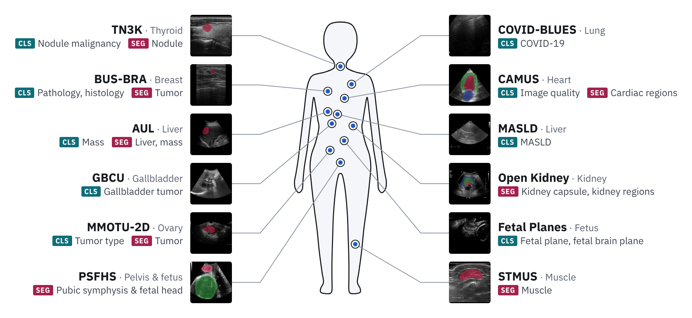

# UltraBench

[](https://arxiv.org/abs/2609.28610)
[](https://adamtupper.github.io/ultrabench/)

UltraBench is a standardized benchmark of 21 convex ultrasound image classification and semantic segmentation tasks drawn from 12 publicly available datasets covering 10 anatomical regions. See below for how to get started, or checkout the [Leaderboard 🏆](https://adamtupper.github.io/ultrabench/#leaderboard) to see how different ultrasound foundation models stack up!

<p align="center">
  
</p>

## Getting Started

Install UltraBench and load any dataset in the collection with one function:

```bash
pip install ultrabench
```

```python
import ultrabench

train_data = ultrabench.load_dataset(name="AUL", split="train")
```

Read the [documentation](https://adamtupper.github.io/ultrabench/getting_started) to learn how to train and evaluate a model, and how to add it to the leaderboard.

## Questions

If you have any questions, please open an issue or contact us via [email](mailto:adam.tupper.1@ulaval.ca).

## How to Cite UltraBench

If you use UltraBench in your research, please cite our article [UltraBench 2: Towards Robust Evaluation of Vision Foundation Models on Ultrasound](https://arxiv.org/abs/2609.28610v1) and the articles for each of the datasets. This ensures that the work of the authors of the original datasets is properly acknowledged, helps more people find the benchmark and encourages us to continue maintaining and improving it!

```bibtex
@misc{radhachandran2026ultrabench2,
  title={UltraBench 2: Towards Robust Evaluation of Vision Foundation Models on Ultrasound},
  author={Ashwath Radhachandran and Adam Tupper and Christian Gagn{\'e} and William Speier},
  year={2026},
  eprint={2609.28610},
  archivePrefix={arXiv},
  primaryClass={cs.CV},
  url={https://arxiv.org/abs/2609.28610}
}
```
